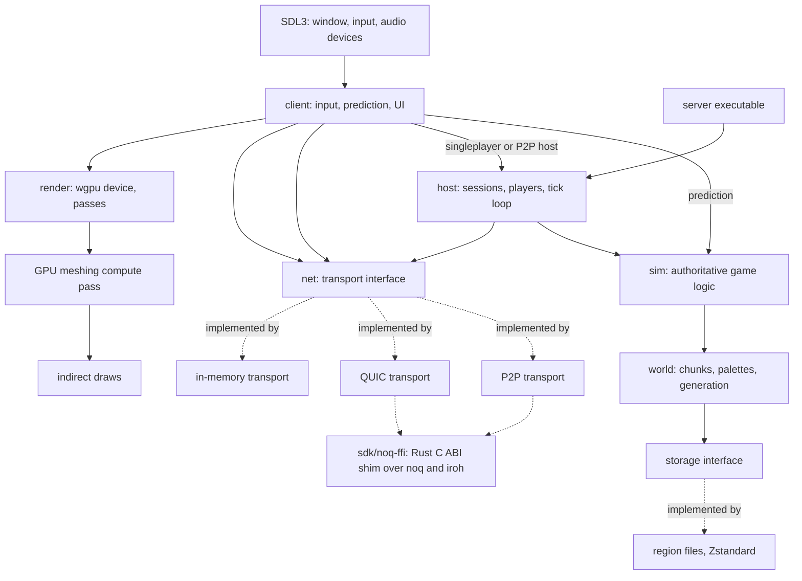

# newtechvoxels

## Overview

New Tech Voxels is an experimental 3D voxel game aiming to harness the strengths of modern software. It is also a research project: it asks whether a modern, data-oriented stack is actually worth it, measured against early Minecraft (Alpha through Beta 1.7.3) on the same machine with matched settings. Every major subsystem is there to test a claim, so it has to be measurable (see Telemetry and benchmarks).

Most of the MVP is built (see Current phase below); the parts still marked "planned" are decisions, not code. When a planned part lands, rewrite its description to say what the code does and drop the marker.

The game is open source, in one monorepo, under two licenses (see Licensing).

### The stack

| Area | Choice | How it's reached | Status |
| --- | --- | --- | --- |
| Language | Odin | toolchain pinned in `mise.toml` | done |
| Windowing and input | SDL3 | `vendor:sdl3` | done |
| Rendering and compute | WebGPU through wgpu-native | `vendor:wgpu`, surface from `vendor:wgpu/sdl3glue`; `just setup` fetches the library | done |
| Shaders | hand-written WGSL in `shaders/` | embedded with `#load`, validated with naga in `just check` | done |
| Network transport | QUIC through noq (n0's fork of Quinn), with iroh for P2P discovery, hole punching and relays | our own Rust C ABI shim, bound from Odin | planned; the in-memory transport is done |
| Network compression | LZ4 | `vendor:compress/lz4` | done |
| World storage compression | Zstandard | `sdk/zstd`, our bindings to libzstd (Odin's vendor collection has none) | done |
| CPU math | SIMD | `core:simd` | later; the hot loops are plain Odin so far |
| Physics (selective) | Box3D | `vendor:box3d` | later |
| Voice chat (toggleable) | Opus over MoQ (iroh-live) | bindings | later |
| Webcam sharing (toggleable) | AV1 (dav1d to decode, an encoder to be picked), AV2 as an experiment | bindings | later |
| Modding | undecided: WebAssembly (leading), Lua or JavaScript | see Modding | later |
| Shader generation | unipute (our Rust shaders-as-code library, `../unipute`) | Odin bindings | later, once unipute is mature |

Choices that are still open: the modding runtime, the AV1 encoder, and whether noq is used directly or through iroh's endpoint API. Don't settle one of them as a side effect of other work. Raise it, and record the decision here when it's made.

### Architecture

- The game logic is authoritative and lives in one place, `src/sim/`. It is a library, not a server: it holds the game state, takes player inputs for a tick, advances the world, and returns what changed. It knows nothing about sockets, threads, windows, clocks or how it is hosted, so the same code runs in every mode.
- `src/host/` drives the simulation for remote or local players: it accepts connections from any transport, maps them to players, runs the fixed tick loop, and sends each player the changes they can see. Every hosting mode is the same host with different parts plugged in:
  - Dedicated server: the `src/server/` executable runs a host with the QUIC transport and no client.
  - Singleplayer: the client runs a host in the same process and connects to it over the in-memory transport.
  - P2P: one peer's client runs a host with the P2P transport, and the other peers connect to it like they would to a dedicated server.

  Adding a hosting mode means adding a transport or a small `main`, never changing `sim` or `host`.
- The client runs the same `sim` code for prediction (moving the local player and showing block edits before the host confirms them) and reconciles with what the host sends. It never has its own copy of a game rule.
- The simulation runs at a fixed tick rate, decoupled from rendering. The renderer interpolates between the last two ticks.
- Chunks are cubic, 32 by 32 by 32 voxels, so world height isn't a hard limit. Block ids are a global `u16`, and each chunk stores a palette plus packed indices sized to the palette (0, 1, 2, 4, 8 or 16 bits). The same packed form goes to the GPU, across the network (under LZ4) and to disk (under Zstandard), so a chunk is never re-encoded between them. Benchmark scenes that compare with Minecraft limit world height to match the version under test.
- Meshing runs on the GPU: chunk data is uploaded raw, the CPU counts the visible faces exactly with popcounts over occupancy bitmasks and allocates that many in one big face buffer, and a compute pass writes the faces and the indirect draw arguments. The CPU never reads geometry back. `src/mesh` holds the CPU reference mesher and the test in `tests/render` compares the two face for face.
- Network traffic is split by what loss means for it: ordered reliable streams for control (join, leave, handshakes), a stream per chunk transfer so one lost packet doesn't stall the others, and unreliable datagrams for state that goes stale (positions, later voice and video). Channel assignments live in one table in `src/net/` and in `docs/networking.md`.

### Layout

The repository is a monorepo. Odin packages are directories; packages under `src/` import each other by relative path (`import "../world"`) and the `sdk` collection is passed with `-collection:sdk=sdk`. A struct field must not share a name with a package the file imports (`sim`, `world`): inside the struct the field shadows the package.

- `src/client/`: the game executable. SDL3 window and event loop, input, the game loop, the benchmark scenes. Runs a host in the same process for singleplayer (and P2P hosting, later).
- `src/server/` (planned): the dedicated, headless server executable, a small `main` around `src/host/` on the QUIC transport. It must build and run without SDL3 or a GPU.
- `src/codec/`: bounds-checked little-endian reading and writing, shared by every format.
- `src/world/`: chunks, palettes, the chunk byte format, block registry, noise and generation, the storage interface with its in-memory implementation, the World container. No rendering or networking imports.
- `src/mesh/`: the face format shared with the shaders, occupancy bitmasks, exact face counting, the CPU reference mesher.
- `src/sim/`: the authoritative game logic as a library (see Architecture). Imports only `src/world/` and `core:`.
- `src/net/`: the transport interface, the in-memory transport, message encoding with LZ4 on chunk payloads. The QUIC transport over `sdk/noq` goes here.
- `src/host/`: sessions, players, the tick loop, chunk streaming and eviction over the transport interface. Shared by every hosting mode.
- `src/session/`: the client side without rendering: joining, the mirrored world, other players, prediction and reconciliation.
- `src/storage/`: region files with Zstandard, implementing the world's storage interface.
- `src/render/`: the wgpu device (with a headless mode), the range allocator, chunk slots, GPU meshing, indirect draws, camera and frustum.
- `src/telemetry/`: per-frame rows, percentile summaries, CSV output.
- `shaders/`: WGSL sources, one file per pipeline, embedded with `#load` so a build has no loose files. `mesh.wgsl` meshes, `chunk.wgsl` draws.
- `sdk/`: BSD-3-Clause code: `sdk/zstd/` today; the modding API, `sdk/noq/` (Odin side) and `sdk/noq-ffi/` (the Rust shim crate) later.
- `tests/`: Odin tests, one package per area, named `test_<area>`.
- `tools/`: helper programs. `tools/setup` fetches wgpu-native. Network condition setups and CSV plotting come later.
- `docs/`: the Zensical site. `docs/benchmarks.md` holds setups and results.

### Reusability and flexibility

The hosting modes above are one case of a rule for the whole codebase: write each piece so it can be reused somewhere else and swapped for another implementation without changing its callers.

- Dependencies point one way: `world` at the bottom, then `sim`, then `host` and `render`, then the executables. A lower package never imports a higher one, and nothing below the executables imports SDL3. If a lower package needs something from above, pass it in (a procedure, an interface, or data) instead of importing it.
- No global state in the libraries. Every procedure gets its state, its allocator and its configuration as parameters or through `context`. Several worlds, simulations and hosts must be able to exist in one process at once (tests, a singleplayer client that also hosts, portals to another dimension, a benchmark that runs many headless clients).
- Seams where implementations differ are explicit interfaces, defined next to their consumer: the transport, storage, the world generator, the mesher (GPU and CPU), later the audio and video codecs and the mod runtime. A runtime choice is a struct of procedures plus a `rawptr` for the implementation's data. A compile-time choice uses parametric polymorphism or `when`. Each interface has at least one in-memory or fake implementation for tests.
- Keep data and the code that moves it apart. Game state, messages and chunk formats are plain structs with no handles in them, so they can be copied, saved, sent, replayed and compared. Encoding to bytes lives in one place per format.
- Behavior that someone may want to change is configuration, not a constant buried in code: tick rate, view distance, network limits, generation parameters. Configuration is a struct passed in by the executable, with defaults in one place. Things that the data formats depend on (chunk size, the block id width) stay compile-time constants, each defined once.
- Game content is data where it can be. Blocks, items and their properties are registered through the same registry the modding API will use, so built-in content and mods go through one path.
- Flexibility is not speculation. Don't add an interface, option or hook that nothing uses yet and that isn't planned in this file; add it when the second implementation or the planned feature arrives. Keeping packages small and free of globals is what makes that later step cheap.

## Licensing

- Everything is AGPL-3.0-or-later unless a directory says otherwise. The root `LICENSE` holds it.
- `sdk/` is BSD-3-Clause, with its own `sdk/LICENSE`, so mods and the reusable bindings can be under any license.
- Code under `sdk/` must not import anything outside `sdk/` or `vendor:`/`core:`. Moving AGPL code into `sdk/` relicenses it, so only do it when the user asks.
- Every new dependency must be compatible with both: permissive (MIT, BSD, Apache-2.0, zlib, ISC) for anything `sdk/` links, and nothing that is incompatible with AGPL anywhere. Check the license before adding it and say what it is in the commit.

## Originality

This is an original game in the voxel sandbox genre, not a copy of Minecraft. Minecraft is the benchmark baseline and a source of player complaints to address (r/minecraftsuggestions and the official feedback site), nothing else.

- No Minecraft code, decompiled or deobfuscated sources, mappings, textures, sounds, models, names of its blocks, items or mobs, or its UI layout. Don't read decompiled Minecraft code to copy a mechanic, even for benchmark parity; describe the behavior from observation instead.
- Art, audio and fonts are made for the project or come from sources whose license allows redistribution under the project's terms. Record the source and license of every third-party asset in `assets/CREDITS.md`.
- When a feature comes from a community suggestion, link the suggestion in the issue or doc that describes it.

## Building and testing

- Odin and the helper tools come from mise. `mise.toml` pins Odin to a monthly release tag (not a nightly), ols (which ships `odinfmt`), just and naga-cli. Rust's version will be pinned in `sdk/noq-ffi/rust-toolchain.toml` once that crate exists. Do not install Odin another way alongside mise.
- Odin links through clang (on Linux the builds use mold through `-linker:mold`), and the game links SDL3, lz4 and zstd from the system. `just setup` downloads the wgpu-native release that `vendor:wgpu` expects into Odin's vendor directory; run it once per machine and after an Odin bump. `tools/setup` pins the wgpu-native version; keep it equal to the one `vendor/wgpu/wgpu.odin` names.
- Commands live in the `justfile` at the root: `just build`, `just run`, `just test`, `just test-one <pkg>`, `just check`, `just fmt`, `just fmt-check`, `just bench`, `just docs`, `just remote <recipe>`. Add a recipe only for a step those don't cover. Compiler flags shared by every build live in the justfile's variables (`check_flags` for `odin check`, `odin_flags` adds the linker), not repeated per recipe.
- Tests use `core:testing` and run with `odin test`, one package per directory under `tests/`. Add a test with every behavior change. They cover palette packing, the chunk codec (round trips, every truncation, bad widths and indices), generation determinism (a pinned hash; update it on purpose and say so in the commit), face counting against the CPU mesher, the GPU mesher against the CPU one, the message encoding (round trips, truncations, oversize and NaN input), the sim from scripted inputs, host and clients in lockstep over the in-memory transport (prediction must match with no corrections), and region files including corrupted ones.
- The GPU test needs an adapter. It logs that it was skipped and passes when none is found, so `just test` runs on headless machines; with Mesa's lavapipe it runs for real on a machine without a GPU, and CI installs `mesa-vulkan-drivers` for that.
- `just check` type-checks every package (`-no-entry-point` for the test packages) and validates every WGSL file with naga, so a shader error fails before the game starts.
- `odin check` gives fast type errors without a full build. Code for another platform can be checked from any machine with `-target:windows_amd64`, `-target:darwin_arm64` and so on. Do this when touching platform code you can't run.
- CI (`.github/workflows/ci.yml`) runs `just setup`, `just check`, `just test`, `just build` and `just fmt-check` on Linux and macOS, building SDL3 from source where apt has no `libsdl3-dev`. Windows waits on a vcpkg setup. It skips changes that only touch `docs/`, Markdown files, `zensical.toml` or the licenses.

## Telemetry and benchmarks

The research question needs numbers, so measurement is a feature, not an afterthought.

- Every subsystem reports its time per frame or tick through `src/telemetry/`. `--bench <scene>` runs a scripted scene (flying through new terrain, mass block edits, many explosions, joining a loaded server, packet loss) and writes a CSV of frame times, tick times, memory, chunk throughput and network bytes.
- Report frame times as percentiles (average, 1% low, 0.1% low), not averages alone.
- A benchmark is only valid with its setup written down: hardware, OS, driver, the build flags, and for the baseline the exact Minecraft version, its settings and JVM flags. These go in `docs/benchmarks.md` next to the results.
- Comparisons must be fair. Match view distance, world height and lighting work to the baseline, and say in the results where a difference can't be matched.
- Don't tune a benchmark scene to flatter the stack. If a result is bad, record it; a bad result is still a research result.

## Odin rules

- Format with `odinfmt` (from ols), configured by `odinfmt.json` at the root. CI rejects unformatted code.
- Build and check with `-vet -strict-style -warnings-as-errors`. Unused imports and variables are errors, not noise.
- Naming follows Odin's core library: `snake_case` for procedures, variables and packages, `Ada_Case` for types, `SCREAMING_SNAKE_CASE` for constants. Foreign procedures keep the C name through `@(link_name)` while the Odin name follows Odin style.
- Memory: say where every allocation goes. Per-frame scratch goes in `context.temp_allocator`, freed once per frame. Long-lived data uses explicit arenas or pools owned by the system that uses it. No allocation inside per-voxel or per-vertex loops. Prefer fixed-capacity arrays and `#soa` where the data is hot.
- Errors are values: procedures that can fail return an error enum or union as the last value, and callers handle it with `or_return` or explicitly. Bytes from the network, from disk or from a mod never cause a panic, an out-of-bounds read or an unbounded allocation. Every length and count from outside is checked against the remaining input and a hard limit before anything is allocated for it, and decompression takes a maximum output size (a small packet must not expand into gigabytes).
- Use `distinct` types for things that shouldn't mix: block ids, chunk coordinates, world coordinates, entity ids.
- Reach for `core:` and `vendor:` before adding a dependency.

## FFI rules

- Bind only what the code calls. Bindings live in their own package under `sdk/` with `foreign import`, and a thin Odin layer on top that takes slices and strings instead of pointer and length pairs.
- Native handles are owned by one Odin struct with a matching `destroy` procedure. Don't copy owning structs.
- The Rust shim (`sdk/noq-ffi/`) exposes a C ABI only: `extern "C"` functions, `#[repr(C)]` types, opaque handles, cbindgen for the header. A panic must never cross the boundary: wrap every exported function so a panic becomes an error code.
- Rust never calls into Odin from its own threads. The shim runs its async runtime on its own threads and hands events (new connection, stream data, datagram) to Odin through a queue that the game drains once per tick. Buffers passed to the shim are copied or stay valid until the shim says it's done with them; the binding documents which.
- Rust code is formatted with `rustfmt`, linted with `cargo clippy -- -D warnings`, and uses edition 2024.

## Shaders

- Hand-written WGSL for now, one file per pipeline in `shaders/`. Keep bind group layouts declared next to the pipeline that uses them in `src/render/`, and keep the WGSL `@group`/`@binding` numbers and the Odin layout in step; a test or startup check compares them.
- Shared structs used by both Odin and WGSL (chunk headers, vertex formats, indirect arguments) are defined once in Odin with `#packed` or explicit alignment, and the WGSL copy says which Odin type it mirrors. Size asserts (`#assert(size_of(T) == N)`) guard the layout.
- unipute will replace the hand-written compute kernels once it's mature. Keep kernels small and plain (no clever preprocessing of WGSL text) so that move is mechanical.

## Modding (later)

Mods will be sandboxed, and the API lives in `sdk/` under BSD-3-Clause. WebAssembly is the leading option because it is sandboxed and language-agnostic (JavaScript through Javy, Rust, Zig, Odin). Lua and JavaScript are still being considered. Whatever runtime is picked, the API is data-oriented: mods record batches of changes into buffers that the engine applies in bulk, never a host call per block. Don't add mod hooks before the runtime is chosen.

## Current phase: finishing the MVP

The MVP is a single-player-capable, multiplayer-ready voxel world with the benchmark harness, and nothing more. Done: the SDL3 window and wgpu renderer, cubic chunks with palettes, deterministic terrain generation, GPU meshing with the CPU reference, breaking and placing blocks, a first-person player with collision, `sim` and `host` with singleplayer over the in-memory transport and client prediction, Zstandard region files, telemetry and the terrain, edits and static scenes. Still to do: the QUIC transport over noq with LZ4 chunk streams, the dedicated server executable, the packet-loss scene, rendering other players, and the first measured comparison. `docs/roadmap.md` tracks it. Out of scope until the MVP is done: P2P, voice, video, physics, modding, unipute, lighting beyond a simple directional light with ambient occlusion. If a task drifts into an out-of-scope area, stop and ask.

## Searching the codebase

Use fast, modern tools instead of the slow defaults:

- [`rg`](https://github.com/BurntSushi/ripgrep) (ripgrep) for text search, not `grep`. It respects `.gitignore` for you.
- [`fd`](https://github.com/sharkdp/fd) for finding files by name, not `find`.
- [`ast-grep`](https://ast-grep.github.io) for structural searches and rewrites in languages it supports (Rust, not Odin or WGSL; use `rg` for those). Call it as `ast-grep`. The `sg` alias is deprecated, so don't use it.
- `jq` for reading and querying JSON.

If your harness has dedicated search or file tools that already wrap these, those are fine too.

## Docs (IMPORTANT!!!)

Always update the docs if necessary when changing or adding code. If the docs already contain outdated information, expand your scope to cover that info too. That includes this file: when the layout, build, stack or tooling change, update the overview and the build section here.

The docs are a [Zensical](https://zensical.org) site: `zensical.toml` at the root, pages in `docs/`. `just docs` (`uvx zensical build --strict`) checks it and writes `site/` (ignored by git), and `just docs-serve` previews it. Pages:

- `index.md`: what the game is, the research question, what exists.
- `getting-started.md`: the toolchain, system libraries per platform, building, running, controls, tests, benchmarks, the remote recipe.
- `architecture.md`: the package graph, chunks and their byte format, generation, world and storage, sim, hosting modes, the client side, known gaps.
- `networking.md`: the transport interface and its implementations, the channel table, the message table, prediction.
- `rendering.md`: the buffers and their budgets, meshing, drawing, headless mode.
- `benchmarks.md`: the scenes, what a reported result must include, results.
- `modding.md`: once a runtime is chosen.
- `roadmap.md`: what's done and what's planned.

Compile the examples you put in the docs before committing them.

When a roadmap item is finished, check it off (`- [x]`) where it is. DO NOT move it into an earlier section like "Done: the MVP". The roadmap shows how each goal is progressing, so finished items stay with the section they belong to.

The README is only an entry point: what the game is, building, and links into the docs. Put details in the docs, not the README.

## Diagrams as Mermaid, not ASCII art

Never draw a flow, pipeline or architecture picture out of characters in a code block. Make a Mermaid diagram instead.

## Outdated packages

PLEASE, PLEASE do not use a package that is old or deprecated. EVEN IF IT IS "INDUSTRY STANDARD" THAT DOES NOT MEAN IT IS GOOD!!! USE THE BEST PACKAGE AND LATEST VERSION LIKE A NORMAL PERSON WOULD!

Check a library's repository for its latest release tag (and whether it is still maintained) before adding or bumping it, whether it's a Rust crate, a C library we bind, or a GitHub Action in the workflows. The same goes for APIs: target current ones (SDL3, not SDL2; WebGPU, not OpenGL fallbacks; current QUIC drafts that noq implements).

## Keep things human

Do not use em dashes or other special symbols not normally found in writing. Do not word things in a weird way. Keep it looking human. If you need to use, for example, an arrow icon, use an SVG instead.

Replacing an em dash with a hyphen is NOT a fix. A spaced hyphen doing an em dash's job ("the limit - 4 bytes", "fast - but wrong") is the same tic with a different character. Reword the sentence instead: use a comma, a colon, parentheses, or the actual word ("minus", "to", "through"). Plain hyphens in compound words and numeric ranges like 0-1 are fine.

## Use American spelling

It's fine to be British in the chat if the person is actually in a region where it's spelled like that. But if not, just use American spelling. The thing itself MUST use American spelling.
