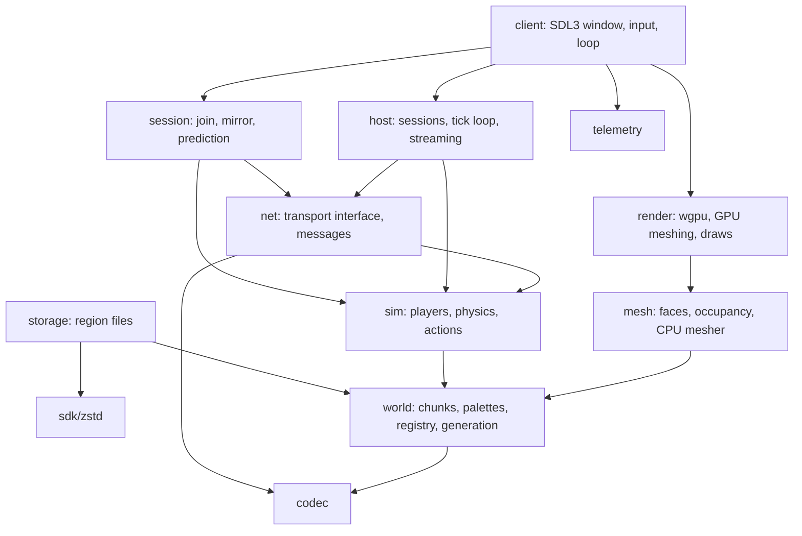

# Architecture

The code is a set of Odin packages that depend one way: `codec` and `world` at the bottom, then `mesh`, `sim`, `net`, then `host`, `session`, `storage`, `render`, `telemetry`, then the executable. Nothing below the executable imports SDL3, and nothing in a library is global state: several worlds, sims and hosts can live in one process.

## Chunks

A chunk is 32×32×32 voxels (`world.CHUNK_SIZE`). It stores a palette of block ids and one packed index per voxel, 0, 1, 2, 4, 8 or 16 bits wide, the narrowest that addresses the palette. Indices never straddle a 32-bit word; voxel `i` is at word `i*bits/32`, shift `i*bits%32`, with `i = (y*32 + z)*32 + x`. Setting a block that the palette doesn't hold appends it and repacks when the width grows; `chunk_compact` rebuilds the palette from what's used.

The byte form (`chunk_encode`) is version, position, bit width, palette, data words. It is canonical (one encoding per chunk) and the decoder checks every count against the remaining input before allocating, refuses widths that don't match the palette size, and rejects indices past the palette. The same bytes are what the renderer uploads (palette words then data words), what `Chunk_Data` carries under LZ4, and what the region files hold under Zstandard.

Block ids are a global `u16` fixed by registration order in `world.Registry`; `register_builtin_blocks` registers the built-in ones in the order of the `Builtin` enum. Mods will register through the same procedure.

## Generation

`world.Generator` is a struct of procedures. `Terrain` is a heightmap from several octaves of smoothed value noise over a splitmix-style integer hash, squared so plains are common. Only integer hashing and `f32` adds and multiplies are used, no transcendental functions, so a seed produces the same bytes everywhere; a test pins the hash of a generated chunk. `Flat` is for tests and benchmark scenes.

## The world and storage

`world.World` holds loaded chunks by position, a registry, a generator and a `Storage`. `world_load_chunk` asks the storage first and generates when it has nothing; `world_unload_chunk` saves a dirty chunk and frees it. `Storage` is another struct of procedures: `Memory_Storage` for tests and sessions that shouldn't touch disk, `storage.File_Storage` for region files (see [Getting started](getting-started.md)). A region file holds an 8×8×8 block of chunks as Zstandard frames behind a table of offsets and lengths; saves append and update the table.

## Simulation

`sim.Sim` is the authoritative game logic: players and a world, advanced by `sim_step` with a map of inputs for one tick. Movement is walk, jump and fly with axis-separated AABB collision against the voxel grid, where unloaded space is solid. Breaking and placing go through an Amanatides-Woo raycast from the eye; placing is refused inside a player. Block changes are appended for the host to broadcast. The sim knows nothing about sockets, threads, windows or clocks.

## Hosting

`host.Host` drives a sim for whoever is connected over a `net.Transport`: connections become sessions, a Join makes a player, inputs are applied with their tick echoed back as an ack, block changes go to the sessions holding that chunk, chunks stream nearest first within a per-tick budget and unload with one chunk of slack, and chunks no player is near are saved and evicted every hundred ticks. `host_advance` turns elapsed seconds into fixed ticks.

Every hosting mode is this host with a different transport:

- Singleplayer: the client creates a `Memory_Hub`, runs a host on it, and connects to it with `memory_connect`.
- Dedicated server: a small executable running a host on the QUIC transport (not yet written).
- P2P: one peer's client runs the host on the P2P transport (later).

## The client side

`session.Client` is everything a client does that isn't rendering: joining, mirroring the world from `Chunk_Data` and `Block_Changed` messages, tracking other players, and predicting the local player with a `Sim` over the mirrored world. That sim has `load_chunks` off, so it never makes chunks of its own; unknown space is solid and the player waits for the host's chunks. Reconciliation snaps to the host's state and replays the inputs newer than the acked tick. Over the in-memory transport in lockstep this needs no corrections at all (a test checks it).

The client executable (`src/client`) runs both sides one tick at a time, client first, so a round trip takes one tick each way as it would over a network; the camera interpolates the predicted player between ticks.

## Known gaps

- A placed block the host refuses (another player in the way) stays in the client's mirror until the chunk is resent.
- `sim` uses `math.sin` and `math.cos`, so two platforms can disagree after many ticks; the host is authoritative, so this only shows up as corrections.
- Region files never reclaim space from overwritten chunks.
